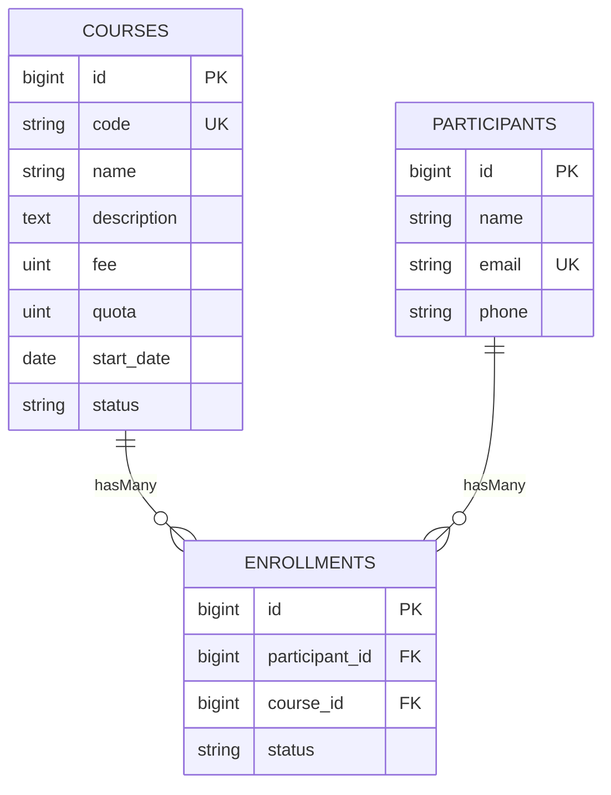

# ERD Final — Week 12

Gambar: [erd-final.svg](erd-final.svg) (buka di browser, lalu screenshot sebagai bukti).

Versi teks (Mermaid, bisa dipratinjau di GitHub / VS Code):

Constraint tambahan pada `enrollments`: `UNIQUE (participant_id, course_id)`, kedua FK `ON DELETE CASCADE`.

## Jawaban checkpoint dosen

1. Jika Alya ikut 3 kursus, berapa baris enrollment? → ........
2. Jika 20 peserta ikut Laravel Dasar, berapa baris enrollment untuk course itu? → ........
3. Mengapa `course_name` tidak perlu disimpan lagi di `enrollments`? → ........
